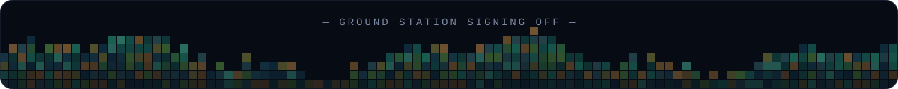

<picture>
  <source media="(prefers-color-scheme: dark)" srcset="./assets/header-dark.svg">
  <source media="(prefers-color-scheme: light)" srcset="./assets/header-light.svg">
  
</picture>

<p align="center">
  <a href="https://www.linkedin.com/in/igorkotlarz"></a>
  
  
</p>

```text
$ whoami
igor — CS engineering student @ Silesian University of Technology (Politechnika Śląska)
       I teach models trained on one sensor to see through another.

$ cat mission.log
[ NOW  ] final semester · engineering thesis on foundation models for satellite data
[ NOW  ] FieldEye — drone-borne crop anomaly detection (RPi + FPGA + camera)
[ NEXT ] thesis defense · 02/2027
[ NEXT ] MSc in ML / computer vision / Earth observation
[ ALWAYS ] hackathons — as many as the calendar physically allows
```

## 🛰️ Current mission

<picture>
  <source media="(prefers-color-scheme: dark)" srcset="./assets/spectrum-dark.svg">
  <source media="(prefers-color-scheme: light)" srcset="./assets/spectrum-light.svg">
  
</picture>

Geospatial foundation models like **TerraMind** and **Prithvi** are pretrained on multispectral imagery with ~13 bands. Real hyperspectral sensors (PRISMA, the HYPERVIEW 2 challenge data) deliver 100–240. My thesis, *Adaptation of foundation models to satellite data analysis*, compares ways to bridge that gap:

| Strategy | Idea |
|---|---|
| **Band selection** | pick the hyperspectral channels closest to what the model already knows |
| **Spectral dimensionality reduction** | compress 240 bands into a pretrained-friendly space |
| **Channel adapters** | a small learned module in front of a frozen backbone |
| **Input-layer fine-tuning** | let the patch embedding learn the new spectrum |

The downstream task: estimating soil trace-element concentrations from hyperspectral + Sentinel-2 data. Prior to that, on the first HYPERVIEW challenge, our team got strong results with classical ML on spectral derivatives, which is a useful reminder that a big model has to earn its place.

## 🚀 Flight log

<table>
<tr>
<td width="50%" valign="top">

### 🌾 FieldEye
**Crop anomaly detection from drone flights.** A custom payload with a camera, Raspberry Pi, sensors and an FPGA for on-board image processing. Team PBL project at university.

`Python` `Computer Vision` `Raspberry Pi` `FPGA`

[→ Kodies-Dev/Fieldeye](https://github.com/Kodies-Dev/Fieldeye)

</td>
<td width="50%" valign="top">

### ☀️ SolarSight
**Solar PV production forecasting, hackathon-built** at ETHSilesia 2026 (Tauron AI Challenge). I built the Flask backend, the weather-API orchestration and a *what-if* simulation endpoint.

`Python` `Flask` `Forecasting` `REST`

[→ Kodies-Dev/Solar-Sight](https://github.com/Kodies-Dev/Solar-Sight)

</td>
</tr>
<tr>
<td width="50%" valign="top">

### 🛰️ HYPERVIEW Challenge
**Soil chemistry from 150 spectral bands.** P, K, Mg and pH estimated from hyperspectral field patches (ESA Φ-lab challenge). The pipeline uses mask-aware smoothing, spectral derivatives, per-target feature selection and leak-free repeated CV.

`Python` `scikit-learn` `XGBoost` `Remote Sensing`

[→ igorkotlarz1/io-hyperview-challenge](https://github.com/igorkotlarz1/io-hyperview-challenge)

</td>
<td width="50%" valign="top">

### ✋ Gesture LED Control
**Lights that follow your hand.** A webcam and MediaPipe track 21 hand landmarks, a gesture state machine turns pinches and raised fingers into brightness and RGB colour, and MQTT carries the result to an ESP32 driving the LEDs.

`Computer Vision` `MediaPipe` `MQTT` `ESP32`

[→ igorkotlarz1/gesture-led-control](https://github.com/igorkotlarz1/gesture-led-control)

</td>
</tr>
<tr>
<td width="50%" valign="top">

### 🐷 Skarbonka
**Local-first AI for settling household expenses.** Import a bank CSV, and rules, ML and a local LLM categorise the spending, then turn it into a settlement report. No transaction ever reaches a cloud AI.

`FastAPI` `PostgreSQL + pgvector` `Ollama` `React`

[→ igorkotlarz1/skarbonka](https://github.com/igorkotlarz1/skarbonka)

</td>
<td width="50%" valign="top">

### 🚶 Walk Cycle EDA
**Does cognitive load erase gait differences?** Motion-capture data from autistic and control walkers, analysed with non-parametric tests and effect sizes. Under a Stroop task the differences mostly disappear.

`R` `tidyverse` `Mann–Whitney U` `Cohen's d`

[→ igorkotlarz1/Walk-cycle-EDA](https://github.com/igorkotlarz1/Walk-cycle-EDA)

</td>
</tr>
</table>

## 🧰 Payload

<p>
  
</p>

<p>
  
  
  
  
  
  
</p>

**ML / EO:** foundation models, transfer learning, hyperspectral imaging, remote sensing · **Data:** ETL, data warehousing, SQL, graph and spatial databases · **Systems:** parallel computing (CUDA, MPI), systems programming in C/C++, computer graphics

📜 Corporate Readiness Certificate: *Data Science in Practice* (2025) · *Data & AI Fundamentals* (2026)

## 🏔️ Off-orbit

```text
climbing  ██████████  10 years on the rock, still falling off it
sailing   ██████▒▒▒▒  reading wind is just feature engineering
running   ████▒▒▒▒▒▒  half-marathon build, Feb 2027
guitar    ███████▒▒▒  metalhead, unapologetically
```

## 📫 Ground station

Up for **hackathon teams, research collaborations and Earth-observation side quests**. The fastest way to reach me is [LinkedIn](https://www.linkedin.com/in/igorkotlarz).

<picture>
  <source media="(prefers-color-scheme: dark)" srcset="./assets/footer-dark.svg">
  <source media="(prefers-color-scheme: light)" srcset="./assets/footer-light.svg">
  
</picture>
